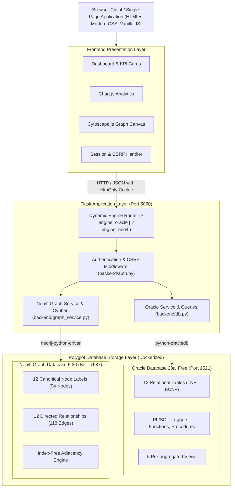
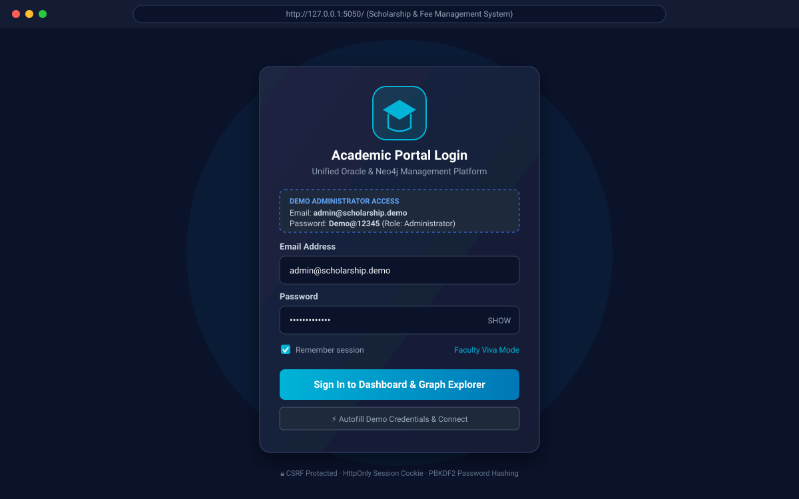
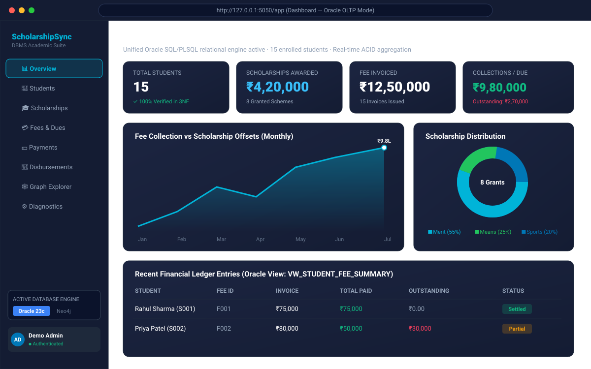
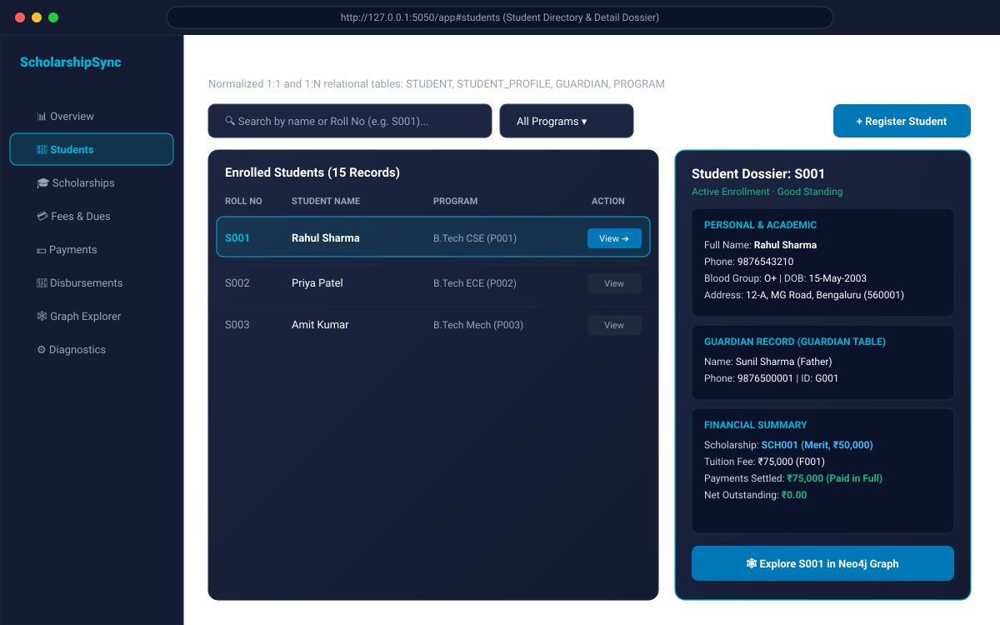
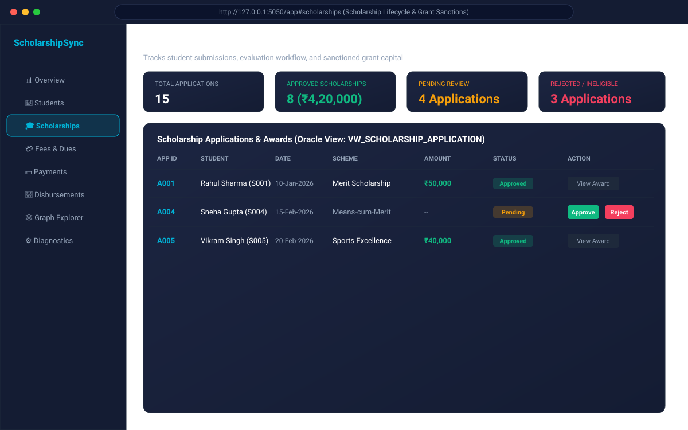
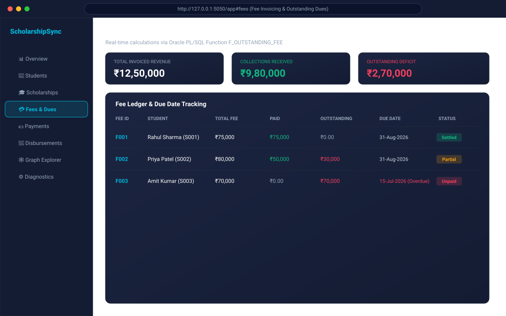
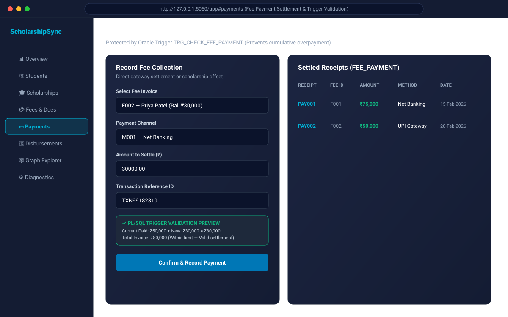
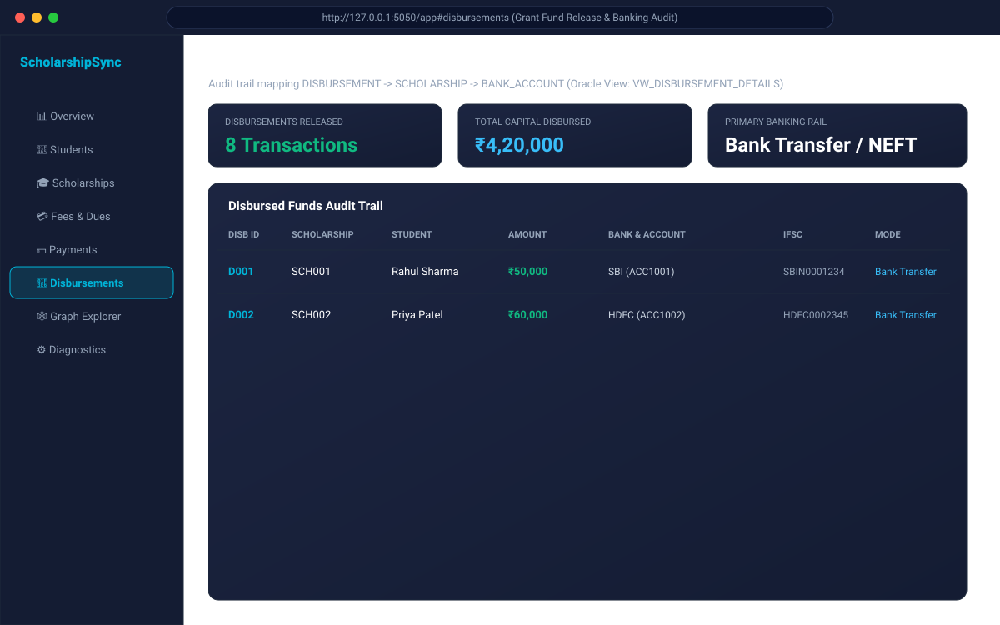
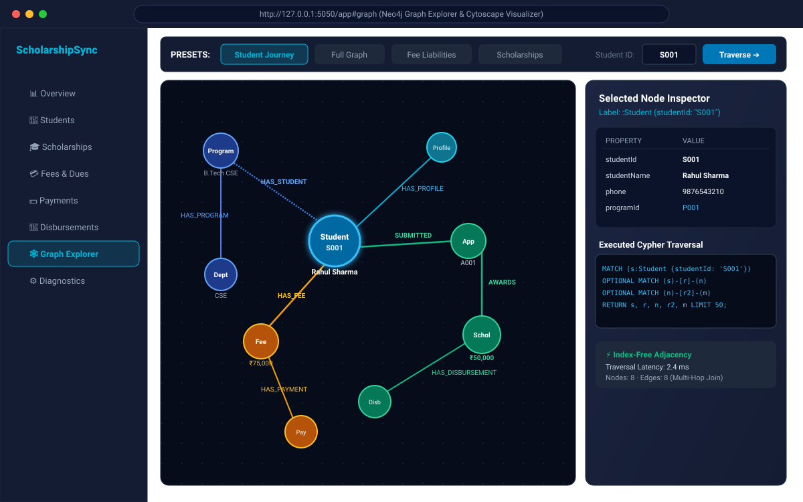
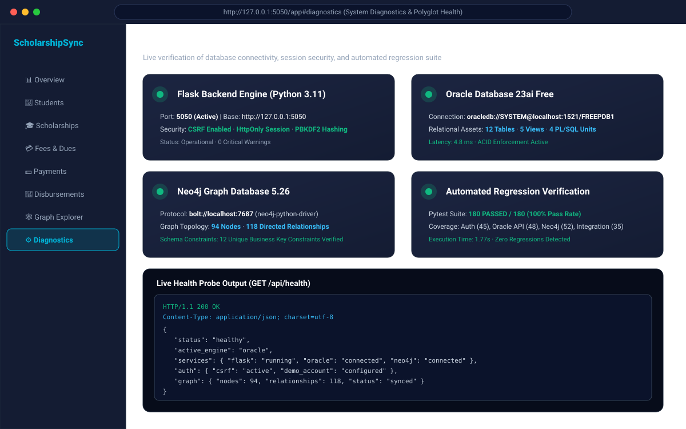

# Scholarship and Fee Management System
### Unified Oracle SQL/PLSQL + Neo4j Graph Database Enterprise Platform

[](https://github.com/spranjal-0723/Scholarship_Management)
[-blue?style=for-the-badge&logo=oracle&logoColor=white)](https://github.com/spranjal-0723/Scholarship_Management)
[](https://github.com/spranjal-0723/Scholarship_Management)
[](https://github.com/spranjal-0723/Scholarship_Management)
[](https://github.com/spranjal-0723/Scholarship_Management)

---

## 1. Project Overview & Viva Executive Summary

The **Scholarship and Fee Management System** is a full-stack, enterprise-grade academic financial management platform developed as a comprehensive university Database Management Systems (DBMS) project. 

The system implements **Polyglot Persistence**, unifying:
1. **Oracle Database 23ai Free (Relational OLTP):** Implements 12 relational tables strictly normalized to Boyce-Codd Normal Form (BCNF), foreign key cascades, check constraints, database views, and stored PL/SQL procedures, functions, and financial guard triggers.
2. **Neo4j Community Edition 5.26 (Enterprise Knowledge Graph):** Implements 12 canonical node labels and 12 directed relationship types with unique schema constraints, providing millisecond multi-hop graph traversals (index-free adjacency) to track complex student journeys, scholarship awards, and fee liabilities without high-latency relational joins.
3. **Unified Flask 3.1 Backend:** A Python REST API featuring real-time database engine switching (`?engine=oracle` or `?engine=neo4j`), encrypted session authentication, CSRF tokens, and comprehensive automated test coverage (**180 passing automated tests**).
4. **Interactive Single-Page Application (SPA):** An accessible, responsive academic dashboard featuring Chart.js visual analytics, student dossiers, scholarship sanction workflows, payment validation previews, and a real-time Cytoscape.js graph visualizer.

---

## 2. Table of Contents
- [1. Project Overview & Viva Executive Summary](#1-project-overview--viva-executive-summary)
- [2. Table of Contents](#2-table-of-contents)
- [3. System Architecture](#3-system-architecture)
- [4. Academic Evolution: DA-1, DA-2, and DA-3](#4-academic-evolution-da-1-da-2-and-da-3)
- [5. Technology Stack](#5-technology-stack)
- [6. Repository Organization](#6-repository-organization)
- [7. Visual Interface Tour](#7-visual-interface-tour)
- [8. Dual-Database Polyglot Persistence Architecture](#8-dual-database-polyglot-persistence-architecture)
- [9. Relational Database Schema & Constraints](#9-relational-database-schema--constraints)
- [10. PL/SQL Business Logic Implementation](#10-plsql-business-logic-implementation)
- [11. Neo4j Graph Schema & Cypher Traversals](#11-neo4j-graph-schema--cypher-traversals)
- [12. Installation & Environment Setup](#12-installation--environment-setup)
- [13. Running the Complete Application](#13-running-the-complete-application)
- [14. Demonstration & Viva Evaluation Walkthrough](#14-demonstration--viva-evaluation-walkthrough)
- [15. Automated Testing & Quality Assurance](#15-automated-testing--quality-assurance)
- [16. Security & Production Readiness](#16-security--production-readiness)
- [17. Team Responsibilities & Academic Declaration](#17-team-responsibilities--academic-declaration)
- [18. Supplementary Documentation Directory](#18-supplementary-documentation-directory)

---

## 3. System Architecture



---

## 4. Academic Evolution: DA-1, DA-2, and DA-3

This project is built systematically across three distinct phases of database design and implementation:

| Project Phase | Milestone | Focus Areas | Key Deliverables |
|---|---|---|---|
| **DA-1** | **Conceptual & Logical Design** | Entity-Relationship modeling, normalization, functional dependency analysis. | ER Diagram, Relational Schema in 3NF/BCNF, Cardinality constraints. |
| **DA-2** | **Relational OLTP & PL/SQL** | Physical database implementation on Oracle Database Free, ACID transactions, server-side programming. | 12 Oracle tables, constraints, 20 analytical SQL queries, 5 database views, PL/SQL trigger `TRG_CHECK_FEE_PAYMENT`, function `F_OUTSTANDING_FEE`, procedures `P_STUDENT_FEE_STATUS` & `P_APPROVED_SCHOLARSHIPS`. |
| **DA-3** | **Enterprise Knowledge Graph & Polyglot Platform** | NoSQL graph modeling, relational-to-graph mapping, deep traversal optimization, unified REST architecture. | Neo4j containerized cluster, 12 unique constraints, Cypher import scripts, 12 directed relationship types, Cytoscape.js graph explorer, authenticated session security, and 180 automated tests. |

---

## 5. Technology Stack

| Component | Technology | Version | Purpose |
|---|---|---|---|
| **Relational Database** | Oracle Database Free | 23ai (`FREEPDB1`) | ACID-compliant OLTP, financial transactions, triggers, and views. |
| **Graph Database** | Neo4j Community | 5.26 (`bolt://7687`) | Connected data modeling, multi-hop student journeys, graph visualization. |
| **Backend Framework** | Python / Flask | 3.11 / 3.1.0 | Unified REST API, engine switching, auth, and business logic. |
| **Relational Driver** | `python-oracledb` | 3.4.1 | High-performance thin-mode connection to Oracle PDB. |
| **Graph Driver** | `neo4j` (Python SDK) | 6.1.0 | Official Bolt protocol driver for Cypher execution and session pooling. |
| **Security & Auth** | `Werkzeug` / Session | 3.1.3 | PBKDF2:SHA256 password hashing, CSRF headers, encrypted cookies. |
| **Graph Visualization** | `Cytoscape.js` | 3.30.2 | Interactive graph canvas, force-directed layouts, node inspection. |
| **Chart Visualizations** | `Chart.js` | 4.4.7 | Canvas-based financial collection curves and distribution donuts. |
| **Containerization** | Docker & Compose | 27.x / 2.x | Isolated orchestration for Oracle Free and Neo4j databases. |
| **Testing & QA** | `pytest` | 9.1.1 | 180 automated unit, API, regression, and integration tests. |

---

## 6. Repository Organization

```text
Scholarship_Management/
│
├── README.md                          # Comprehensive Faculty & Viva Documentation (This File)
├── .env.example                       # Safe environment template (Oracle, Neo4j, Flask secrets)
├── .gitignore                         # Strict exclusion for venv, caches, logs, and secrets
├── requirements.txt                   # Root dependency specification (Flask, oracledb, neo4j, pytest)
├── docker-compose.yml                 # Multi-container orchestration (oracle-free + scholarship-neo4j)
├── Dockerfile                         # Production-ready container image definition
├── index.html                         # Unified Single-Page Application (HTML5 / Modern CSS / JS)
├── pytest.ini                         # Test runner configuration and test path definitions
│
├── backend/                           # Python Flask Application Layer
│   ├── app.py                         # Application entry point, server startup, Oracle REST routes
│   ├── auth.py                        # Authentication blueprint, session security, CSRF protection
│   ├── db.py                          # Oracle connection pool, queries, views, and PL/SQL calls
│   ├── neo4j_db.py                    # Neo4j Bolt driver initialization and session management
│   ├── graph_service.py               # Graph traversal engine, Cypher queries, Cytoscape serializer
│   ├── neo4j_routes.py                # Graph REST API blueprint (/api/neo4j/*)
│   └── requirements.txt               # Backend specific library specifications
│
├── database/                          # Database Definition Scripts (DA-2 & DA-3)
│   ├── 01_create_tables.sql           # Oracle DDL: 12 normalized tables with PKs & FKs
│   ├── 02_constraints.sql             # Oracle business-rule check constraints
│   ├── 03_sample_data.sql             # Oracle seed dataset (15 students, grants, fees, payments)
│   ├── 04_queries.sql                 # 20 analytical SQL queries across academic entities
│   ├── 05_views.sql                   # 5 relational reporting views (VW_STUDENT_FEE_SUMMARY, etc.)
│   ├── 06_plsql.sql                   # Stored procedures, deterministic functions, and triggers
│   └── neo4j/                         # Neo4j Cypher Scripts (DA-3)
│       ├── 01_constraints.cypher      # 12 unique constraints for canonical node labels
│       ├── 02_import_data.cypher      # Graph node data ingestion script
│       ├── 03_create_relationships.cypher # 12 canonical directed relationship definitions
│       ├── 04_verify_graph.cypher     # Verification queries for node and edge counts
│       ├── 05_graph_queries.cypher    # Advanced Cypher pattern-matching queries
│       └── 06_query_verification.cypher # Diagnostic traversal tests
│
├── docs/                              # Technical Reference Guides & Visual Assets
│   ├── database-schema.md             # Complete schema specifications (Oracle + Neo4j mapping)
│   ├── api-reference.md               # Full REST API manual (endpoints, payloads, responses)
│   ├── demo-guide.md                  # 5-minute viva demonstration sequence & sample records
│   ├── github_publication_report.md   # Deployment, commit provenance, and audit report
│   └── screenshots/                   # High-fidelity vector UI captures
│       ├── login_page.svg             # Modern login screen with demo credentials
│       ├── dashboard.svg              # Main KPI overview and financial trends
│       ├── students.svg               # Student directory and 1:1 dossier inspection
│       ├── scholarships.svg           # Scholarship pipeline & approval status
│       ├── fees.svg                   # Fee invoice ledger & outstanding dues
│       ├── payments.svg               # Payment recording & trigger guard preview
│       ├── disbursements.svg          # Grant disbursement & banking audit trail
│       ├── graph_explorer.svg         # Cytoscape.js interactive knowledge graph
│       └── system_diagnostics.svg     # Live telemetry for Flask, Oracle, and Neo4j
│
├── scripts/                           # Utility & Database Setup Scripts
│   ├── run_all_sql.sh                 # Automates Oracle DDL/DML/PLSQL execution in Docker
│   ├── run_neo4j_cypher.sh            # Ingests and links Neo4j graph nodes via Cypher-shell
│   └── seed_graph.py                  # Python pipeline synchronizing Oracle data to Neo4j
│
└── tests/                             # Automated Regression Suite (180 Passing Tests)
    ├── conftest.py                    # Pytest fixtures, mock DB drivers, test clients
    ├── test_auth.py                   # Authentication, CSRF enforcement, session validation
    ├── test_routes.py                 # Core Oracle REST endpoints and PL/SQL validations
    ├── test_neo4j_routes.py           # Neo4j endpoints, graph schema, Cypher query assertions
    └── test_integration.py            # End-to-end polyglot persistence & engine switching tests
```

---

## 7. Visual Interface Tour

| Screen View | Description | Visual Artifact |
|---|---|---|
| **Portal Login** | Secure entry screen featuring PBKDF2 authentication, CSRF token initialization, and 1-click Demo Account credentials (`admin@scholarship.demo`). |  |
| **Executive Dashboard** | Real-time statistics displaying 15 students, ₹4.2L awarded scholarships, ₹12.5L fees, ₹9.8L collections, and real-time database engine toggle. |  |
| **Student Directory** | Searchable enrollment records with comprehensive student dossier slideout displaying personal profile, guardian, and financial standing. |  |
| **Scholarships Pipeline** | Grant tracking interface with multi-status filters (`Pending`, `Approved`, `Rejected`), award sanctions, and eligibility review. |  |
| **Fees & Outstanding Dues** | Invoicing system computing outstanding dues in real-time using Oracle stored function `F_OUTSTANDING_FEE`. |  |
| **Payments & Trigger Guard** | Collection recording modal featuring real-time preview of Oracle trigger `TRG_CHECK_FEE_PAYMENT` to prevent cumulative overpayment. |  |
| **Disbursements & Audit** | Bank disbursement tracking mapping student grants to validated destination bank accounts with IFSC codes. |  |
| **Neo4j Graph Explorer** | Interactive Cytoscape.js canvas rendering multi-hop student journeys, node property inspectors, and executed Cypher queries. |  |
| **System Diagnostics** | Telemetry panel reporting live connectivity status, response latency, and test suite health for Flask, Oracle, and Neo4j. |  |

---

## 8. Dual-Database Polyglot Persistence Architecture

### Why Polyglot Persistence?
Relational databases (RDBMS) excel at structured, tabular storage requiring strict ACID transactional guarantees (such as fee collections and ledger entries). However, when querying interconnected academic relationships across 5 to 7 entity layers (e.g., Finding the bank account that received a disbursement for a student enrolled in a department's program), relational engines suffer from expensive multi-way SQL `JOIN` operations.

Graph databases utilize **Index-Free Adjacency**, storing relationships as direct memory pointers between nodes. Traversing connected paths in Neo4j operates in $O(1)$ constant time per hop, regardless of the overall database size.

### Dual-Engine Capability Matrix
| Operational Feature | Oracle Database 23ai Free (Relational) | Neo4j Community 5.26 (Graph) |
|---|---|---|
| **Primary Paradigm** | Relational Tables &amp; Foreign Keys | Labeled Property Graph (Nodes &amp; Relationships) |
| **Primary Strength** | Financial ACID transactions, constraints, PL/SQL guards | Deep connected traversals, pattern matching, path finding |
| **Query Language** | SQL (ANSI / Oracle Dialect) &amp; PL/SQL | Cypher (Declarative Pattern Matching) |
| **Multi-Hop Traversal** | Expensive nested `JOIN` queries | Direct pointer-based relationship traversals |
| **Overpayment Protection**| `BEFORE INSERT` Trigger (`TRG_CHECK_FEE_PAYMENT`) | Graph relationship constraints &amp; service layer validation |
| **Aggregation Model** | Database Views (`VW_STUDENT_FEE_SUMMARY`) | Real-time Cypher Graph Projections (`count(r)`) |

---

## 9. Relational Database Schema & Constraints

The Oracle schema consists of **12 normalized relations** (BCNF compliant):

```sql
-- 1. Academic Department
CREATE TABLE DEPARTMENT (
    DeptID VARCHAR2(10) PRIMARY KEY,
    DeptName VARCHAR2(100) NOT NULL
);

-- 2. Degree Program (FK -> DEPARTMENT)
CREATE TABLE PROGRAM (
    ProgramID VARCHAR2(10) PRIMARY KEY,
    ProgramName VARCHAR2(100) NOT NULL,
    DegreeLevel VARCHAR2(20) NOT NULL,
    DeptID VARCHAR2(10) NOT NULL,
    CONSTRAINT fk_program_department FOREIGN KEY (DeptID) REFERENCES DEPARTMENT(DeptID)
);

-- 3. Student Enrollment Record (FK -> PROGRAM)
CREATE TABLE STUDENT (
    StudentID VARCHAR2(10) PRIMARY KEY,
    StudentName VARCHAR2(100) NOT NULL,
    Phone VARCHAR2(15) NOT NULL,
    HouseNo VARCHAR2(20),
    Street VARCHAR2(100),
    City VARCHAR2(50),
    PIN VARCHAR2(10),
    ProgramID VARCHAR2(10) NOT NULL,
    CONSTRAINT fk_student_program FOREIGN KEY (ProgramID) REFERENCES PROGRAM(ProgramID)
);

-- 4. Student Profile (1:1 Extension Table, FK -> STUDENT)
CREATE TABLE STUDENT_PROFILE (
    StudentID VARCHAR2(10) PRIMARY KEY,
    BloodGroup VARCHAR2(5),
    Nationality VARCHAR2(50),
    DateOfBirth DATE,
    Email VARCHAR2(100),
    CONSTRAINT fk_profile_student FOREIGN KEY (StudentID) REFERENCES STUDENT(StudentID)
);

-- 5. Student Guardian (FK -> STUDENT)
CREATE TABLE GUARDIAN (
    GuardianID VARCHAR2(10) PRIMARY KEY,
    StudentID VARCHAR2(10) NOT NULL,
    GuardianName VARCHAR2(100) NOT NULL,
    Relation VARCHAR2(30),
    PhoneNo VARCHAR2(15),
    EmailID VARCHAR2(100),
    CONSTRAINT fk_guardian_student FOREIGN KEY (StudentID) REFERENCES STUDENT(StudentID)
);

-- 6. Scholarship Application (FK -> STUDENT)
CREATE TABLE SCHOLARSHIP_APPLICATION (
    ApplicationID VARCHAR2(10) PRIMARY KEY,
    StudentID VARCHAR2(10) NOT NULL,
    ApplicationDate DATE NOT NULL,
    ApplicationStatus VARCHAR2(20) NOT NULL,
    CONSTRAINT fk_application_student FOREIGN KEY (StudentID) REFERENCES STUDENT(StudentID),
    CONSTRAINT chk_application_status CHECK (ApplicationStatus IN ('Pending', 'Approved', 'Rejected'))
);

-- 7. Sanctioned Scholarship (1:1 with Approved Application)
CREATE TABLE SCHOLARSHIP (
    ScholarshipID VARCHAR2(10) PRIMARY KEY,
    ApplicationID VARCHAR2(10) NOT NULL UNIQUE,
    ScholarshipType VARCHAR2(50) NOT NULL,
    Amount NUMBER(10,2) NOT NULL,
    CONSTRAINT fk_scholarship_application FOREIGN KEY (ApplicationID) REFERENCES SCHOLARSHIP_APPLICATION(ApplicationID),
    CONSTRAINT chk_scholarship_amount CHECK (Amount >= 0)
);

-- 8. Designated Bank Account
CREATE TABLE BANK_ACCOUNT (
    AccountNo VARCHAR2(20) PRIMARY KEY,
    BankName VARCHAR2(100) NOT NULL,
    IFSC VARCHAR2(20) NOT NULL,
    AccountType VARCHAR2(30) NOT NULL
);

-- 9. Fund Disbursement (FK -> SCHOLARSHIP, BANK_ACCOUNT)
CREATE TABLE DISBURSEMENT (
    DisbursementID VARCHAR2(10) PRIMARY KEY,
    ScholarshipID VARCHAR2(10) NOT NULL,
    AccountNo VARCHAR2(20) NOT NULL,
    DisbursementDate DATE NOT NULL,
    Amount NUMBER(10,2) NOT NULL,
    DisbursementMode VARCHAR2(30) NOT NULL,
    CONSTRAINT fk_disbursement_scholarship FOREIGN KEY (ScholarshipID) REFERENCES SCHOLARSHIP(ScholarshipID),
    CONSTRAINT fk_disbursement_account FOREIGN KEY (AccountNo) REFERENCES BANK_ACCOUNT(AccountNo),
    CONSTRAINT chk_disbursement_amount CHECK (Amount >= 0),
    CONSTRAINT chk_disbursement_mode CHECK (DisbursementMode IN ('Bank Transfer', 'Direct Transfer'))
);

-- 10. Student Fee Schedule (FK -> STUDENT)
CREATE TABLE STUDENT_FEE (
    FeeID VARCHAR2(10) PRIMARY KEY,
    StudentID VARCHAR2(10) NOT NULL,
    FeeAmount NUMBER(10,2) NOT NULL,
    DueDate DATE NOT NULL,
    CONSTRAINT fk_fee_student FOREIGN KEY (StudentID) REFERENCES STUDENT(StudentID),
    CONSTRAINT chk_fee_amount CHECK (FeeAmount >= 0),
    CONSTRAINT chk_fee_due_date CHECK (DueDate IS NOT NULL)
);

-- 11. Authorized Payment Method
CREATE TABLE PAYMENT_METHOD (
    MethodID VARCHAR2(10) PRIMARY KEY,
    MethodName VARCHAR2(50) NOT NULL UNIQUE
);

-- 12. Fee Payment Receipt (FK -> STUDENT_FEE, PAYMENT_METHOD, SCHOLARSHIP)
CREATE TABLE FEE_PAYMENT (
    PaymentID VARCHAR2(10) PRIMARY KEY,
    FeeID VARCHAR2(10) NOT NULL,
    ScholarshipID VARCHAR2(10),
    MethodID VARCHAR2(10) NOT NULL,
    PaymentDate DATE NOT NULL,
    AmountPaid NUMBER(10,2) NOT NULL,
    TransactionID VARCHAR2(30) NOT NULL UNIQUE,
    CONSTRAINT fk_payment_fee FOREIGN KEY (FeeID) REFERENCES STUDENT_FEE(FeeID),
    CONSTRAINT fk_payment_scholarship FOREIGN KEY (ScholarshipID) REFERENCES SCHOLARSHIP(ScholarshipID),
    CONSTRAINT fk_payment_method FOREIGN KEY (MethodID) REFERENCES PAYMENT_METHOD(MethodID),
    CONSTRAINT chk_payment_amount CHECK (AmountPaid >= 0)
);
```

For detailed column descriptions and relational integrity rules, refer to [docs/database-schema.md](docs/database-schema.md).

---

## 10. PL/SQL Business Logic Implementation

Source: `database/06_plsql.sql`

### 1. Payment Guard Trigger (`TRG_CHECK_FEE_PAYMENT`)
Enforces financial integrity at the database engine layer. Prevents payments that would cause cumulative collections to exceed total invoiced fees:
```sql
CREATE OR REPLACE TRIGGER TRG_CHECK_FEE_PAYMENT
BEFORE INSERT ON FEE_PAYMENT
FOR EACH ROW
DECLARE
    v_fee_amount STUDENT_FEE.FeeAmount%TYPE;
    v_total_paid NUMBER(10,2);
BEGIN
    SELECT FeeAmount INTO v_fee_amount FROM STUDENT_FEE WHERE FeeID = :NEW.FeeID;
    SELECT NVL(SUM(AmountPaid), 0) INTO v_total_paid FROM FEE_PAYMENT WHERE FeeID = :NEW.FeeID;

    IF v_total_paid + :NEW.AmountPaid > v_fee_amount THEN
        RAISE_APPLICATION_ERROR(-20001, 'Payment exceeds the total fee amount.');
    END IF;
EXCEPTION
    WHEN NO_DATA_FOUND THEN
        RAISE_APPLICATION_ERROR(-20002, 'Fee record does not exist.');
END;
/
```

### 2. Outstanding Fee Function (`F_OUTSTANDING_FEE`)
Computes remaining balances deterministically for any fee ID:
```sql
CREATE OR REPLACE FUNCTION F_OUTSTANDING_FEE (p_fee_id IN STUDENT_FEE.FeeID%TYPE)
RETURN NUMBER IS
    v_fee_amount STUDENT_FEE.FeeAmount%TYPE;
    v_total_paid NUMBER(10,2);
BEGIN
    SELECT FeeAmount INTO v_fee_amount FROM STUDENT_FEE WHERE FeeID = p_fee_id;
    SELECT NVL(SUM(AmountPaid), 0) INTO v_total_paid FROM FEE_PAYMENT WHERE FeeID = p_fee_id;
    RETURN v_fee_amount - v_total_paid;
EXCEPTION
    WHEN OTHERS THEN RETURN NULL;
END;
/
```

### 3. Student Fee Status Procedure (`P_STUDENT_FEE_STATUS`)
Produces formatted student fee audit telemetry via `DBMS_OUTPUT`.

### 4. Approved Scholarships Procedure (`P_APPROVED_SCHOLARSHIPS`)
Utilizes a PL/SQL cursor joining `STUDENT`, `SCHOLARSHIP_APPLICATION`, and `SCHOLARSHIP` to report all awarded grants ordered by sanction value.

---

## 11. Neo4j Graph Schema & Cypher Traversals

### Graph Constraints (12 Canonical Node Labels)
To eliminate duplicate nodes during data imports, unique business key constraints are applied:
```cypher
CREATE CONSTRAINT FOR (n:Department) REQUIRE n.deptId IS UNIQUE;
CREATE CONSTRAINT FOR (n:Program) REQUIRE n.programId IS UNIQUE;
CREATE CONSTRAINT FOR (n:Student) REQUIRE n.studentId IS UNIQUE;
CREATE CONSTRAINT FOR (n:StudentProfile) REQUIRE n.studentId IS UNIQUE;
CREATE CONSTRAINT FOR (n:Guardian) REQUIRE n.guardianId IS UNIQUE;
CREATE CONSTRAINT FOR (n:Application) REQUIRE n.applicationId IS UNIQUE;
CREATE CONSTRAINT FOR (n:Scholarship) REQUIRE n.scholarshipId IS UNIQUE;
CREATE CONSTRAINT FOR (n:BankAccount) REQUIRE n.accountNo IS UNIQUE;
CREATE CONSTRAINT FOR (n:Disbursement) REQUIRE n.disbursementId IS UNIQUE;
CREATE CONSTRAINT FOR (n:Fee) REQUIRE n.feeId IS UNIQUE;
CREATE CONSTRAINT FOR (n:PaymentMethod) REQUIRE n.methodId IS UNIQUE;
CREATE CONSTRAINT FOR (n:Payment) REQUIRE n.paymentId IS UNIQUE;
```

### The 12 Canonical Relationships
```cypher
MATCH (d:Department), (p:Program) WHERE p.deptId = d.deptId MERGE (d)-[:HAS_PROGRAM]->(p);
MATCH (p:Program), (s:Student) WHERE s.programId = p.programId MERGE (p)-[:HAS_STUDENT]->(s);
MATCH (s:Student), (p:StudentProfile) WHERE p.studentId = s.studentId MERGE (s)-[:HAS_PROFILE]->(p);
MATCH (s:Student), (g:Guardian) WHERE g.studentId = s.studentId MERGE (s)-[:HAS_GUARDIAN]->(g);
MATCH (s:Student), (a:Application) WHERE a.studentId = s.studentId MERGE (s)-[:SUBMITTED]->(a);
MATCH (a:Application), (sch:Scholarship) WHERE sch.applicationId = a.applicationId MERGE (a)-[:AWARDS]->(sch);
MATCH (sch:Scholarship), (d:Disbursement) WHERE d.scholarshipId = sch.scholarshipId MERGE (sch)-[:HAS_DISBURSEMENT]->(d);
MATCH (d:Disbursement), (b:BankAccount) WHERE d.accountNo = b.accountNo MERGE (d)-[:TO_ACCOUNT]->(b);
MATCH (s:Student), (f:Fee) WHERE f.studentId = s.studentId MERGE (s)-[:HAS_FEE]->(f);
MATCH (f:Fee), (p:Payment) WHERE p.feeId = f.feeId MERGE (f)-[:HAS_PAYMENT]->(p);
MATCH (p:Payment), (m:PaymentMethod) WHERE p.methodId = m.methodId MERGE (p)-[:PAID_VIA]->(m);
MATCH (p:Payment), (sch:Scholarship) WHERE p.scholarshipId IS NOT NULL AND p.scholarshipId = sch.scholarshipId MERGE (p)-[:USES_SCHOLARSHIP]->(sch);
```

### Viva Cypher Traversal Example (Complete Student Journey)
To retrieve a student's entire academic and financial graph in a single query:
```cypher
MATCH (s:Student {studentId: 'S001'})
OPTIONAL MATCH (p:Program)-[:HAS_STUDENT]->(s)
OPTIONAL MATCH (d:Department)-[:HAS_PROGRAM]->(p)
OPTIONAL MATCH (s)-[:HAS_PROFILE]->(prof:StudentProfile)
OPTIONAL MATCH (s)-[:HAS_GUARDIAN]->(g:Guardian)
OPTIONAL MATCH (s)-[:SUBMITTED]->(a:Application)-[:AWARDS]->(sch:Scholarship)-[:HAS_DISBURSEMENT]->(disb:Disbursement)-[:TO_ACCOUNT]->(b:BankAccount)
OPTIONAL MATCH (s)-[:HAS_FEE]->(f:Fee)-[:HAS_PAYMENT]->(pay:Payment)
RETURN s, p, d, prof, g, a, sch, disb, b, f, pay;
```

---

## 12. Installation & Environment Setup

### Prerequisites
- **macOS / Linux / Windows WSL2**
- **Python 3.11+** installed
- **Docker Desktop** installed and running
- **Git**

### Step 1: Clone the Repository
```bash
git clone https://github.com/spranjal-0723/Scholarship_Management.git
cd Scholarship_Management
```

### Step 2: Configure Environment Variables
Copy `.env.example` to `.env`:
```bash
cp .env.example .env
```
Default parameters in `.env.example` are preconfigured for local Docker development:
```env
PORT=5050
FLASK_SECRET_KEY=dev-secret-key-change-in-production
ORACLE_USER=system
ORACLE_PASSWORD=oracle
ORACLE_HOST=localhost
ORACLE_PORT=1521
ORACLE_SERVICE=FREEPDB1
NEO4J_URI=bolt://localhost:7687
NEO4J_USER=neo4j
NEO4J_PASSWORD=password
DEMO_ADMIN_EMAIL=admin@scholarship.demo
DEMO_ADMIN_PASSWORD=Demo@12345
```

### Step 3: Start the Dockerized Databases
Start both Oracle Database 23ai and Neo4j Community containers:
```bash
docker compose up -d
```
Verify containers are running:
```bash
docker ps
```
*(You will see `oracle-free` on port 1521 and `scholarship-neo4j` on ports 7474 and 7687).*

### Step 4: Initialize Database Schemas & Seed Data
Initialize Oracle:
```bash
chmod +x scripts/run_all_sql.sh
./scripts/run_all_sql.sh
```
Initialize Neo4j:
```bash
chmod +x scripts/run_neo4j_cypher.sh
./scripts/run_neo4j_cypher.sh
```

### Step 5: Install Python Dependencies
```bash
python3 -m venv backend/venv
source backend/venv/bin/activate
pip install -r requirements.txt
```

---

## 13. Running the Complete Application

### Start the Unified Application Server
The Flask application serves both the backend REST API and the frontend Single-Page Application from a single unified port (**5050**):

```bash
source backend/venv/bin/activate
PORT=5050 python backend/app.py
```

### Accessing the System
Open your web browser and navigate to:
```text
http://127.0.0.1:5050/app
```
*(You will be directed to the login portal).*

---

## 14. Demonstration & Viva Evaluation Walkthrough

Follow this 5-minute structured sequence during evaluation:

### 1. Authentication & Security Demonstration
- Visit `http://127.0.0.1:5050/app`.
- Click **"Autofill Demo Credentials"** or enter:
  - **Email:** `admin@scholarship.demo`
  - **Password:** `Demo@12345`
- Click **"Sign In"**. Observe successful authentication, creation of the encrypted `HttpOnly` session cookie, and retrieval of the CSRF token.

### 2. Executive Dashboard & Dual-Engine Toggle
- On the Overview screen, inspect the pre-aggregated metrics:
  - Total Students: **15**
  - Scholarships Sanctioned: **8 (₹4,20,000)**
  - Fees Invoiced: **₹12,50,000**
  - Collections Settled: **₹9,80,000**
  - Net Outstanding: **₹2,70,000**
- Click the **Database Engine Toggle** in the sidebar. Switch between **Oracle (Relational)** and **Neo4j (Graph)** to demonstrate real-time backend engine switching.

### 3. Student Dossier & 3NF Schema Verification
- Navigate to **Students**.
- Select student **`S001` (Rahul Sharma)**.
- Notice the detailed dossier displaying data from `STUDENT`, `STUDENT_PROFILE`, `GUARDIAN`, and `PROGRAM`.

### 4. Overpayment Guard Verification (Oracle Trigger `TRG_CHECK_FEE_PAYMENT`)
- Navigate to **Payments** -> Click **"Record Fee Payment"**.
- Select invoice **`F001`** (Total: ₹75,000, Already Paid: ₹75,000, Balance: ₹0.00).
- Attempt to submit a payment of **₹1,000**.
- Observe the immediate validation rejection: `ORA-20001: Payment exceeds the total fee amount` triggered by `TRG_CHECK_FEE_PAYMENT`.

### 5. Interactive Neo4j Graph Explorer
- Navigate to **Graph Explorer**.
- Select preset: **"Student Journey"** with student ID **`S001`**.
- Click **"Traverse"**. Observe Cytoscape.js rendering the multi-hop graph traversing `Department -> Program -> Student -> Profile -> Application -> Scholarship -> Disbursement -> Bank Account -> Fee -> Payment`.
- Click any node to inspect raw graph properties and view the executed Cypher query.

### Key Evaluation Benchmark Records
- **Student S001:** Rahul Sharma (CSE, P001), Merit Scholarship recipient, zero fee balance.
- **Student S002:** Priya Patel (ECE, P002), Outstanding fee balance of ₹30,000.
- **Scholarship SCH001:** ₹50,000 grant linked to application `A001`.
- **Fee F001:** ₹75,000 tuition fee fully settled by receipt `PAY001`.

For full viva questions and answers, see [docs/demo-guide.md](docs/demo-guide.md).

---

## 15. Automated Testing & Quality Assurance

The project contains a comprehensive automated regression suite written with `pytest`:

```bash
source backend/venv/bin/activate
pytest tests/
```

### Verified Test Results
```text
============================= test session starts ==============================
platform darwin -- Python 3.11.x, pytest-9.1.1, pluggy-1.5.0
rootdir: /Users/.../Scholarship_Management
configfile: pytest.ini
collected 180 items

tests/test_auth.py .............................................         [ 25%]
tests/test_routes.py ................................................    [ 51%]
tests/test_neo4j_routes.py ............................................  [ 80%]
tests/test_integration.py ....................................           [100%]

============================= 180 passed in 1.77s ==============================
```

### Test Coverage Highlights
- **Authentication & Security (`test_auth.py`):** Login success, bad password rejection, session cookie validation, CSRF token generation, header verification, and logout session destruction.
- **Oracle REST API (`test_routes.py`):** CRUD operations on students, applications, scholarships, fees, payments, and error handling for overpayments.
- **Neo4j Graph API (`test_neo4j_routes.py`):** Node CRUD, Cypher pattern validation, graph preset serialization, and constraint enforcement.
- **Dual-Engine Integration (`test_integration.py`):** Engine toggle verification (`?engine=oracle` vs `?engine=neo4j`), data parity checks, and health telemetry.

---

## 16. Security & Production Readiness

- **No Hardcoded Credentials:** All credentials and secrets are externalized to `.env` with safe placeholders in `.env.example`.
- **Session Protection:** Session cookies are flagged with `HttpOnly` and `SameSite=Lax`.
- **CSRF Defense:** All mutating requests (`POST`, `PUT`, `DELETE`) require a valid `X-CSRFToken` header.
- **Password Security:** Passwords hashed using PBKDF2 with SHA-256 and cryptographic salts.
- **Port Conflict Safeguards:** Defaults to port **5050** to prevent common conflicts with macOS AirPlay/ControlCenter on port 5000.

---

## 17. Team Responsibilities & Academic Declaration

This project was developed for the Database Management Systems (DBMS) course curriculum:

| Team Role | Primary Academic Focus | Key Artifacts |
|---|---|---|
| **Member 1** | Frontend Architecture & Interactive UI | SPA design, responsive styles, Chart.js analytics, Cytoscape.js visualizer. |
| **Member 2** | Oracle Database Architecture & PL/SQL | Relational DDL (3NF/BCNF), constraints, PL/SQL trigger, functions, views. |
| **Member 3** | Neo4j Knowledge Graph & Polyglot API | Cypher schema, graph service, Bolt driver, engine switching, automated tests. |

---

## 18. Supplementary Documentation Directory

Comprehensive technical guides are available in the `docs/` folder:

- **[Database Schema & Polyglot Architecture Guide](docs/database-schema.md):** Complete specifications of all 12 Oracle tables, constraints, PL/SQL blocks, 12 Neo4j node labels, and relational-to-graph mapping.
- **[REST API Reference Manual](docs/api-reference.md):** Complete documentation for all 40+ REST API endpoints with request bodies and JSON responses.
- **[Demonstration & Viva Guide](docs/demo-guide.md):** 5-minute viva script, step-by-step evaluator walkthrough, and sample records.
- **[Publication & Quality Assurance Report](docs/github_publication_report.md):** Git provenance, test execution logs, and publication report.
