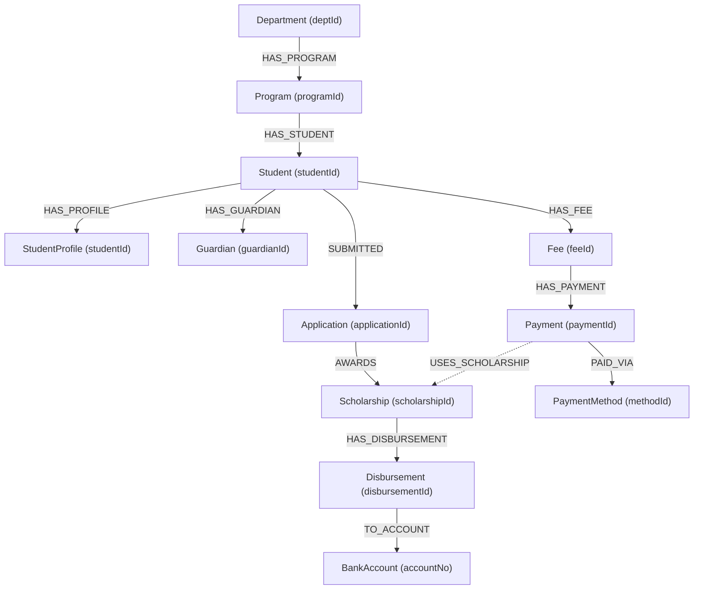

# Database Schema & Polyglot Architecture Guide

**Project:** Scholarship & Fee Management System  
**Architecture:** Polyglot Persistence (Oracle Database 23ai + Neo4j Graph Database 5.26)  
**Academic Alignment:** Relational OLTP (DA-2) & Enterprise Knowledge Graph (DA-3)

---

## Table of Contents
1. [Architectural Overview & Polyglot Model](#1-architectural-overview--polyglot-model)
2. [Oracle Relational Schema (12 Tables)](#2-oracle-relational-schema-12-tables)
3. [Integrity Constraints & Business Rules](#3-integrity-constraints--business-rules)
4. [PL/SQL Business Logic (Procedures, Functions, Triggers)](#4-plsql-business-logic-procedures-functions-triggers)
5. [Database Views (Reporting & Dashboards)](#5-database-views-reporting--dashboards)
6. [Neo4j Graph Schema (12 Node Labels & 12 Relationships)](#6-neo4j-graph-schema-12-node-labels--12-relationships)
7. [Relational-to-Graph Mapping Matrix](#7-relational-to-graph-mapping-matrix)
8. [Database Normalization Analysis (1NF to BCNF)](#8-database-normalization-analysis-1nf-to-bcnf)

---

## 1. Architectural Overview & Polyglot Model

The **Scholarship and Fee Management System** implements a dual-database polyglot architecture designed to maximize transaction safety while providing millisecond graph traversals for academic tracking:

```
+-----------------------------------------------------------------------------------+
|                              FLASK APPLICATION LAYER                              |
|   Unified REST API with Dynamic Engine Switching (?engine=oracle | ?engine=neo4j)  |
+-----------------------------------------+-----------------------------------------+
                                          |
                   +----------------------+----------------------+
                   |                                             |
                   v                                             v
+-------------------------------------+       +-------------------------------------+
|        ORACLE DATABASE 23ai         |       |         NEO4J GRAPH DATABASE        |
|-------------------------------------|       |-------------------------------------|
| * 12 Relational Normalized Tables   |       | * 12 Canonical Node Labels          |
| * ACID Transaction Enforcement      |       | * 12 Directed Relationships         |
| * PL/SQL Financial Guard Triggers   |       | * Declarative Cypher Traversal      |
| * Complex Analytical Views & Joins  |       | * Native Multi-Hop Graph Traversal  |
| * Relational Financial OLTP Storage |       | * Interactive Cytoscape.js Explorer |
+-------------------------------------+       +-------------------------------------+
```

- **Oracle Database 23ai Free:** Serves as the primary ACID-compliant relational system of record. Enforces entity integrity, relational foreign keys, check constraints, financial calculation functions, and payment-preventing triggers.
- **Neo4j Graph Database 5.26 Community:** Serves as the connected academic knowledge graph. Eliminates high-latency multi-table joins across deep chains (e.g., Department -> Program -> Student -> Application -> Scholarship -> Disbursement -> Bank Account) using index-free adjacency.

---

## 2. Oracle Relational Schema (12 Tables)

Source: `database/01_create_tables.sql`

### 1. `DEPARTMENT`
Stores academic departments.
| Column | Data Type | Constraints | Description |
|---|---|---|---|
| `DeptID` | `VARCHAR2(10)` | `PRIMARY KEY` | Unique department code (e.g., `D001`) |
| `DeptName` | `VARCHAR2(100)` | `NOT NULL` | Full name of the academic department |

### 2. `PROGRAM`
Stores degree programs offered by departments.
| Column | Data Type | Constraints | Description |
|---|---|---|---|
| `ProgramID` | `VARCHAR2(10)` | `PRIMARY KEY` | Unique program identifier (e.g., `P001`) |
| `ProgramName` | `VARCHAR2(100)` | `NOT NULL` | Degree program title (e.g., `B.Tech CSE`) |
| `DegreeLevel` | `VARCHAR2(20)` | `NOT NULL` | Degree level (`Undergraduate`, `Postgraduate`, `Doctoral`) |
| `DeptID` | `VARCHAR2(10)` | `NOT NULL`, `FK -> DEPARTMENT(DeptID)` | Owning department |

### 3. `STUDENT`
Core student enrollment record.
| Column | Data Type | Constraints | Description |
|---|---|---|---|
| `StudentID` | `VARCHAR2(10)` | `PRIMARY KEY` | Unique student roll number (e.g., `S001`) |
| `StudentName` | `VARCHAR2(100)` | `NOT NULL` | Full name of the student |
| `Phone` | `VARCHAR2(15)` | `NOT NULL` | Primary contact number |
| `HouseNo` | `VARCHAR2(20)` | `NULLABLE` | Residential house/flat number |
| `Street` | `VARCHAR2(100)` | `NULLABLE` | Residential street name |
| `City` | `VARCHAR2(50)` | `NULLABLE` | City of residence |
| `PIN` | `VARCHAR2(10)` | `NULLABLE` | Postal code |
| `ProgramID` | `VARCHAR2(10)` | `NOT NULL`, `FK -> PROGRAM(ProgramID)` | Enrolled program |

### 4. `STUDENT_PROFILE`
1:1 extension table holding personal and demographic attributes.
| Column | Data Type | Constraints | Description |
|---|---|---|---|
| `StudentID` | `VARCHAR2(10)` | `PRIMARY KEY`, `FK -> STUDENT(StudentID)` | Linked student roll number |
| `BloodGroup` | `VARCHAR2(5)` | `NULLABLE` | Medical blood group (`A+`, `O-`, etc.) |
| `Nationality` | `VARCHAR2(50)` | `NULLABLE` | Country of citizenship |
| `DateOfBirth` | `DATE` | `NULLABLE` | Date of birth |
| `Email` | `VARCHAR2(100)` | `NULLABLE` | Institutional or personal email address |

### 5. `GUARDIAN`
Stores emergency contact and guardian relationships.
| Column | Data Type | Constraints | Description |
|---|---|---|---|
| `GuardianID` | `VARCHAR2(10)` | `PRIMARY KEY` | Unique guardian identifier (e.g., `G001`) |
| `StudentID` | `VARCHAR2(10)` | `NOT NULL`, `FK -> STUDENT(StudentID)` | Associated student |
| `GuardianName` | `VARCHAR2(100)` | `NOT NULL` | Full name of the parent/guardian |
| `Relation` | `VARCHAR2(30)` | `NULLABLE` | Relationship (`Father`, `Mother`, `Guardian`) |
| `PhoneNo` | `VARCHAR2(15)` | `NULLABLE` | Guardian contact number |
| `EmailID` | `VARCHAR2(100)` | `NULLABLE` | Guardian email address |

### 6. `SCHOLARSHIP_APPLICATION`
Tracks student scholarship submissions and evaluation status.
| Column | Data Type | Constraints | Description |
|---|---|---|---|
| `ApplicationID` | `VARCHAR2(10)` | `PRIMARY KEY` | Unique application ID (e.g., `A001`) |
| `StudentID` | `VARCHAR2(10)` | `NOT NULL`, `FK -> STUDENT(StudentID)` | Applicant student |
| `ApplicationDate` | `DATE` | `NOT NULL` | Date when application was submitted |
| `ApplicationStatus` | `VARCHAR2(20)` | `NOT NULL`, `CHECK IN ('Pending', 'Approved', 'Rejected')` | Review status |

### 7. `SCHOLARSHIP`
Granted financial awards mapped to approved applications.
| Column | Data Type | Constraints | Description |
|---|---|---|---|
| `ScholarshipID` | `VARCHAR2(10)` | `PRIMARY KEY` | Unique award identifier (e.g., `SCH001`) |
| `ApplicationID` | `VARCHAR2(10)` | `NOT NULL UNIQUE`, `FK -> SCHOLARSHIP_APPLICATION` | 1:1 link to approved application |
| `ScholarshipType`| `VARCHAR2(50)` | `NOT NULL` | Scheme name (e.g., `Merit Scholarship`) |
| `Amount` | `NUMBER(10,2)` | `NOT NULL`, `CHECK (Amount >= 0)` | Total sanctioned grant value |

### 8. `BANK_ACCOUNT`
Designated disbursement bank accounts.
| Column | Data Type | Constraints | Description |
|---|---|---|---|
| `AccountNo` | `VARCHAR2(20)` | `PRIMARY KEY` | Bank account number (e.g., `ACC1001`) |
| `BankName` | `VARCHAR2(100)` | `NOT NULL` | Name of the banking institution |
| `IFSC` | `VARCHAR2(20)` | `NOT NULL` | Indian Financial System Code |
| `AccountType` | `VARCHAR2(30)` | `NOT NULL` | Account category (`Savings`, `Current`) |

### 9. `DISBURSEMENT`
Fund release transactions towards awarded scholarships.
| Column | Data Type | Constraints | Description |
|---|---|---|---|
| `DisbursementID`| `VARCHAR2(10)` | `PRIMARY KEY` | Unique disbursement record (e.g., `D001`) |
| `ScholarshipID` | `VARCHAR2(10)` | `NOT NULL`, `FK -> SCHOLARSHIP(ScholarshipID)` | Parent scholarship award |
| `AccountNo` | `VARCHAR2(20)` | `NOT NULL`, `FK -> BANK_ACCOUNT(AccountNo)` | Destination bank account |
| `DisbursementDate`| `DATE` | `NOT NULL` | Date when funds were transferred |
| `Amount` | `NUMBER(10,2)` | `NOT NULL`, `CHECK (Amount >= 0)` | Disbursed installment amount |
| `DisbursementMode`| `VARCHAR2(30)`| `NOT NULL`, `CHECK IN ('Bank Transfer', 'Direct Transfer')` | Payment rail |

### 10. `STUDENT_FEE`
Academic tuition and term fee liabilities.
| Column | Data Type | Constraints | Description |
|---|---|---|---|
| `FeeID` | `VARCHAR2(10)` | `PRIMARY KEY` | Fee schedule identifier (e.g., `F001`) |
| `StudentID` | `VARCHAR2(10)` | `NOT NULL`, `FK -> STUDENT(StudentID)` | Invoiced student |
| `FeeAmount` | `NUMBER(10,2)` | `NOT NULL`, `CHECK (FeeAmount >= 0)` | Total invoiced fee payable |
| `DueDate` | `DATE` | `NOT NULL`, `CHECK (DueDate IS NOT NULL)` | Payment settlement deadline |

### 11. `PAYMENT_METHOD`
Available financial channels for fee payment.
| Column | Data Type | Constraints | Description |
|---|---|---|---|
| `MethodID` | `VARCHAR2(10)` | `PRIMARY KEY` | Payment channel code (e.g., `M001`) |
| `MethodName` | `VARCHAR2(50)` | `NOT NULL UNIQUE` | Channel title (`Net Banking`, `UPI`, `Credit Card`) |

### 12. `FEE_PAYMENT`
Settlement receipts for student fees.
| Column | Data Type | Constraints | Description |
|---|---|---|---|
| `PaymentID` | `VARCHAR2(10)` | `PRIMARY KEY` | Receipt identifier (e.g., `PAY001`) |
| `FeeID` | `VARCHAR2(10)` | `NOT NULL`, `FK -> STUDENT_FEE(FeeID)` | Fee invoice being paid |
| `ScholarshipID` | `VARCHAR2(10)` | `NULLABLE`, `FK -> SCHOLARSHIP(ScholarshipID)` | Optional offset scholarship |
| `MethodID` | `VARCHAR2(10)` | `NOT NULL`, `FK -> PAYMENT_METHOD(MethodID)` | Payment method utilized |
| `PaymentDate` | `DATE` | `NOT NULL` | Payment execution timestamp |
| `AmountPaid` | `NUMBER(10,2)` | `NOT NULL`, `CHECK (AmountPaid >= 0)` | Amount collected |
| `TransactionID`| `VARCHAR2(30)` | `NOT NULL UNIQUE` | Gateway or bank reference number |

---

## 3. Integrity Constraints & Business Rules

Source: `database/01_create_tables.sql` and `database/02_constraints.sql`

| Constraint Name | Type | Target Table | Expression / Target | Purpose |
|---|---|---|---|---|
| `fk_program_department` | FOREIGN KEY | `PROGRAM` | `DeptID -> DEPARTMENT(DeptID)` | Prevents orphaned academic programs |
| `fk_student_program` | FOREIGN KEY | `STUDENT` | `ProgramID -> PROGRAM(ProgramID)` | Enforces enrollment in valid program |
| `fk_profile_student` | FOREIGN KEY | `STUDENT_PROFILE` | `StudentID -> STUDENT(StudentID)` | 1:1 student profile relationship |
| `fk_guardian_student` | FOREIGN KEY | `GUARDIAN` | `StudentID -> STUDENT(StudentID)` | Associates guardians to existing students |
| `fk_application_student` | FOREIGN KEY | `SCHOLARSHIP_APPLICATION` | `StudentID -> STUDENT(StudentID)` | Ensures applications link to students |
| `fk_scholarship_application` | FOREIGN KEY | `SCHOLARSHIP` | `ApplicationID -> SCHOLARSHIP_APPLICATION` | Enforces scholarship origin |
| `fk_disbursement_scholarship`| FOREIGN KEY | `DISBURSEMENT` | `ScholarshipID -> SCHOLARSHIP` | Prevents unallocated disbursements |
| `fk_disbursement_account` | FOREIGN KEY | `DISBURSEMENT` | `AccountNo -> BANK_ACCOUNT(AccountNo)` | Ensures valid banking endpoint |
| `fk_fee_student` | FOREIGN KEY | `STUDENT_FEE` | `StudentID -> STUDENT(StudentID)` | Associates fee invoices to students |
| `fk_payment_fee` | FOREIGN KEY | `FEE_PAYMENT` | `FeeID -> STUDENT_FEE(FeeID)` | Links payments to valid fees |
| `fk_payment_scholarship` | FOREIGN KEY | `FEE_PAYMENT` | `ScholarshipID -> SCHOLARSHIP` | Allows scholarship fee adjustments |
| `fk_payment_method` | FOREIGN KEY | `FEE_PAYMENT` | `MethodID -> PAYMENT_METHOD(MethodID)` | Enforces authorized payment methods |
| `chk_application_status` | CHECK | `SCHOLARSHIP_APPLICATION` | `ApplicationStatus IN ('Pending', 'Approved', 'Rejected')` | Restricts lifecycle states |
| `chk_scholarship_amount` | CHECK | `SCHOLARSHIP` | `Amount >= 0` | Prevents negative grant allocations |
| `chk_disbursement_amount` | CHECK | `DISBURSEMENT` | `Amount >= 0` | Prevents negative payout transactions |
| `chk_disbursement_mode` | CHECK | `DISBURSEMENT` | `DisbursementMode IN ('Bank Transfer', 'Direct Transfer')` | Controls payout channels |
| `chk_fee_amount` | CHECK | `STUDENT_FEE` | `FeeAmount >= 0` | Prevents negative invoice charges |
| `chk_fee_due_date` | CHECK | `STUDENT_FEE` | `DueDate IS NOT NULL` | Mandates payment deadlines |
| `chk_payment_amount` | CHECK | `FEE_PAYMENT` | `AmountPaid >= 0` | Prevents negative payments |
| `uq_payment_method_name` | UNIQUE | `PAYMENT_METHOD` | `MethodName` | Prevents duplicate channel definitions |

---

## 4. PL/SQL Business Logic (Procedures, Functions, Triggers)

Source: `database/06_plsql.sql`

### 1. `TRG_CHECK_FEE_PAYMENT` (Database Trigger)
- **Type:** `BEFORE INSERT ON FEE_PAYMENT FOR EACH ROW`
- **Objective:** Strictly prevents overpayment on student fees.
- **Mechanism:**
  1. Queries `STUDENT_FEE.FeeAmount` for `:NEW.FeeID`.
  2. Queries `NVL(SUM(AmountPaid), 0)` from `FEE_PAYMENT` for `:NEW.FeeID`.
  3. If `v_total_paid + :NEW.AmountPaid > v_fee_amount`, raises application error `-20001: Payment exceeds the total fee amount.`
  4. If fee record does not exist, raises `-20002: Fee record does not exist.`

### 2. `F_OUTSTANDING_FEE` (Stored Function)
- **Signature:** `F_OUTSTANDING_FEE(p_fee_id IN STUDENT_FEE.FeeID%TYPE) RETURN NUMBER`
- **Objective:** Deterministically computes the remaining balance for any given fee schedule.
- **Formula:** `Outstanding = FeeAmount - SUM(AmountPaid)`
- **Safety:** Catches `NO_DATA_FOUND` and returns `NULL`.

### 3. `P_STUDENT_FEE_STATUS` (Stored Procedure)
- **Signature:** `P_STUDENT_FEE_STATUS(p_student_id IN STUDENT.StudentID%TYPE)`
- **Objective:** Displays complete fee standing for a student via `DBMS_OUTPUT`:
  - Student Name
  - Total Fee Invoiced
  - Total Payments Received
  - Net Outstanding Balance

### 4. `P_APPROVED_SCHOLARSHIPS` (Stored Procedure)
- **Signature:** `P_APPROVED_SCHOLARSHIPS`
- **Objective:** Cursor-based reporting procedure iterating through all students with approved scholarships:
  - Cursor joins `STUDENT`, `SCHOLARSHIP_APPLICATION`, and `SCHOLARSHIP`.
  - Filters `ApplicationStatus = 'Approved'`.
  - Orders by `Amount DESC`.
  - Outputs formatted record summary to `DBMS_OUTPUT`.

---

## 5. Database Views (Reporting & Dashboards)

Source: `database/05_views.sql`

```sql
-- 1. Academic Structure & Student Directory
CREATE OR REPLACE VIEW VW_STUDENT_ACADEMIC AS
SELECT s.StudentID, s.StudentName, s.Phone, p.ProgramID, p.ProgramName, p.DegreeLevel, d.DeptID, d.DeptName
FROM STUDENT s
JOIN PROGRAM p ON s.ProgramID = p.ProgramID
JOIN DEPARTMENT d ON p.DeptID = d.DeptID;

-- 2. Application & Scholarship Grant Summary
CREATE OR REPLACE VIEW VW_SCHOLARSHIP_APPLICATION AS
SELECT sa.ApplicationID, s.StudentID, s.StudentName, sa.ApplicationDate, sa.ApplicationStatus,
       sc.ScholarshipID, sc.ScholarshipType, sc.Amount AS ScholarshipAmount
FROM SCHOLARSHIP_APPLICATION sa
JOIN STUDENT s ON sa.StudentID = s.StudentID
LEFT JOIN SCHOLARSHIP sc ON sa.ApplicationID = sc.ApplicationID;

-- 3. Invoiced Fees, Collections, and Outstanding Balances
CREATE OR REPLACE VIEW VW_STUDENT_FEE_SUMMARY AS
SELECT s.StudentID, s.StudentName, sf.FeeID, sf.FeeAmount,
       NVL(SUM(fp.AmountPaid), 0) AS TotalPaid,
       sf.FeeAmount - NVL(SUM(fp.AmountPaid), 0) AS OutstandingAmount
FROM STUDENT s
JOIN STUDENT_FEE sf ON s.StudentID = sf.StudentID
LEFT JOIN FEE_PAYMENT fp ON sf.FeeID = fp.FeeID
GROUP BY s.StudentID, s.StudentName, sf.FeeID, sf.FeeAmount;

-- 4. Audit Trail for Scholarship Fund Release
CREATE OR REPLACE VIEW VW_DISBURSEMENT_DETAILS AS
SELECT d.DisbursementID, s.StudentID, s.StudentName, sc.ScholarshipID, sc.ScholarshipType,
       d.Amount AS DisbursedAmount, d.DisbursementDate, d.DisbursementMode,
       b.AccountNo, b.BankName, b.IFSC
FROM DISBURSEMENT d
JOIN SCHOLARSHIP sc ON d.ScholarshipID = sc.ScholarshipID
JOIN SCHOLARSHIP_APPLICATION sa ON sc.ApplicationID = sa.ApplicationID
JOIN STUDENT s ON sa.StudentID = s.StudentID
JOIN BANK_ACCOUNT b ON d.AccountNo = b.AccountNo;

-- 5. Administrative Pipeline of Unprocessed Applications
CREATE OR REPLACE VIEW VW_PENDING_APPLICATIONS AS
SELECT sa.ApplicationID, s.StudentID, s.StudentName, s.Phone, sa.ApplicationDate, sa.ApplicationStatus
FROM SCHOLARSHIP_APPLICATION sa
JOIN STUDENT s ON sa.StudentID = s.StudentID
WHERE sa.ApplicationStatus = 'Pending';
```

---

## 6. Neo4j Graph Schema (12 Node Labels & 12 Relationships)

Source: `database/neo4j/01_constraints.cypher` and `database/neo4j/03_create_relationships.cypher`

### Canonical Node Labels & Unique Keys
Every entity from the relational schema corresponds to an indexed node label in Neo4j with unique constraint enforcement:

```cypher
CREATE CONSTRAINT department_deptId_unique       IF NOT EXISTS FOR (n:Department)     REQUIRE n.deptId IS UNIQUE;
CREATE CONSTRAINT program_programId_unique       IF NOT EXISTS FOR (n:Program)        REQUIRE n.programId IS UNIQUE;
CREATE CONSTRAINT student_studentId_unique       IF NOT EXISTS FOR (n:Student)        REQUIRE n.studentId IS UNIQUE;
CREATE CONSTRAINT studentProfile_studentId_unique IF NOT EXISTS FOR (n:StudentProfile) REQUIRE n.studentId IS UNIQUE;
CREATE CONSTRAINT guardian_guardianId_unique     IF NOT EXISTS FOR (n:Guardian)       REQUIRE n.guardianId IS UNIQUE;
CREATE CONSTRAINT application_applicationId_unique IF NOT EXISTS FOR (n:Application)  REQUIRE n.applicationId IS UNIQUE;
CREATE CONSTRAINT scholarship_scholarshipId_unique IF NOT EXISTS FOR (n:Scholarship)  REQUIRE n.scholarshipId IS UNIQUE;
CREATE CONSTRAINT bankAccount_accountNo_unique   IF NOT EXISTS FOR (n:BankAccount)   REQUIRE n.accountNo IS UNIQUE;
CREATE CONSTRAINT disbursement_disbursementId_unique IF NOT EXISTS FOR (n:Disbursement) REQUIRE n.disbursementId IS UNIQUE;
CREATE CONSTRAINT fee_feeId_unique               IF NOT EXISTS FOR (n:Fee)            REQUIRE n.feeId IS UNIQUE;
CREATE CONSTRAINT paymentMethod_methodId_unique  IF NOT EXISTS FOR (n:PaymentMethod)  REQUIRE n.methodId IS UNIQUE;
CREATE CONSTRAINT payment_paymentId_unique       IF NOT EXISTS FOR (n:Payment)        REQUIRE n.paymentId IS UNIQUE;
```

### The 12 Canonical Graph Relationships



Cypher Relationship Definitions:
```cypher
// 1. Department -> Program
MATCH (d:Department), (p:Program) WHERE p.deptId = d.deptId MERGE (d)-[:HAS_PROGRAM]->(p);

// 2. Program -> Student
MATCH (p:Program), (s:Student) WHERE s.programId = p.programId MERGE (p)-[:HAS_STUDENT]->(s);

// 3. Student -> StudentProfile
MATCH (s:Student), (p:StudentProfile) WHERE p.studentId = s.studentId MERGE (s)-[:HAS_PROFILE]->(p);

// 4. Student -> Guardian
MATCH (s:Student), (g:Guardian) WHERE g.studentId = s.studentId MERGE (s)-[:HAS_GUARDIAN]->(g);

// 5. Student -> Application
MATCH (s:Student), (a:Application) WHERE a.studentId = s.studentId MERGE (s)-[:SUBMITTED]->(a);

// 6. Application -> Scholarship
MATCH (a:Application), (sch:Scholarship) WHERE sch.applicationId = a.applicationId MERGE (a)-[:AWARDS]->(sch);

// 7. Scholarship -> Disbursement
MATCH (sch:Scholarship), (d:Disbursement) WHERE d.scholarshipId = sch.scholarshipId MERGE (sch)-[:HAS_DISBURSEMENT]->(d);

// 8. Disbursement -> BankAccount
MATCH (d:Disbursement), (b:BankAccount) WHERE d.accountNo = b.accountNo MERGE (d)-[:TO_ACCOUNT]->(b);

// 9. Student -> Fee
MATCH (s:Student), (f:Fee) WHERE f.studentId = s.studentId MERGE (s)-[:HAS_FEE]->(f);

// 10. Fee -> Payment
MATCH (f:Fee), (p:Payment) WHERE p.feeId = f.feeId MERGE (f)-[:HAS_PAYMENT]->(p);

// 11. Payment -> PaymentMethod
MATCH (p:Payment), (m:PaymentMethod) WHERE p.methodId = m.methodId MERGE (p)-[:PAID_VIA]->(m);

// 12. Payment -> Scholarship (Optional Offset)
MATCH (p:Payment), (sch:Scholarship)
WHERE p.scholarshipId IS NOT NULL AND p.scholarshipId = sch.scholarshipId
MERGE (p)-[:USES_SCHOLARSHIP]->(sch);
```

---

## 7. Relational-to-Graph Mapping Matrix

| Relational Entity (Oracle Table) | Primary Key | Foreign Key Target | Graph Entity (Neo4j Node) | Unique Node Key | Relationship Outgoing | Target Node |
|---|---|---|---|---|---|---|
| `DEPARTMENT` | `DeptID` | — | `:Department` | `deptId` | `[:HAS_PROGRAM]` | `:Program` |
| `PROGRAM` | `ProgramID` | `DeptID` | `:Program` | `programId` | `[:HAS_STUDENT]` | `:Student` |
| `STUDENT` | `StudentID` | `ProgramID` | `:Student` | `studentId` | `[:HAS_PROFILE]`<br>`[:HAS_GUARDIAN]`<br>`[:SUBMITTED]`<br>`[:HAS_FEE]` | `:StudentProfile`<br>`:Guardian`<br>`:Application`<br>`:Fee` |
| `STUDENT_PROFILE` | `StudentID` | `StudentID` | `:StudentProfile` | `studentId` | — | — |
| `GUARDIAN` | `GuardianID` | `StudentID` | `:Guardian` | `guardianId` | — | — |
| `SCHOLARSHIP_APPLICATION` | `ApplicationID` | `StudentID` | `:Application` | `applicationId` | `[:AWARDS]` | `:Scholarship` |
| `SCHOLARSHIP` | `ScholarshipID` | `ApplicationID` | `:Scholarship` | `scholarshipId` | `[:HAS_DISBURSEMENT]` | `:Disbursement` |
| `BANK_ACCOUNT` | `AccountNo` | — | `:BankAccount` | `accountNo` | — | — |
| `DISBURSEMENT` | `DisbursementID` | `ScholarshipID`<br>`AccountNo` | `:Disbursement` | `disbursementId` | `[:TO_ACCOUNT]` | `:BankAccount` |
| `STUDENT_FEE` | `FeeID` | `StudentID` | `:Fee` | `feeId` | `[:HAS_PAYMENT]` | `:Payment` |
| `PAYMENT_METHOD` | `MethodID` | — | `:PaymentMethod` | `methodId` | — | — |
| `FEE_PAYMENT` | `PaymentID` | `FeeID`<br>`MethodID`<br>`ScholarshipID` | `:Payment` | `paymentId` | `[:PAID_VIA]`<br>`[:USES_SCHOLARSHIP]` | `:PaymentMethod`<br>`:Scholarship` |

---

## 8. Database Normalization Analysis (1NF to BCNF)

### First Normal Form (1NF)
- **Rule:** Every attribute must contain only atomic (indivisible) values; no repeating groups or arrays.
- **Verification:** All 12 tables contain strictly scalar column types (`VARCHAR2`, `NUMBER`, `DATE`). Student addresses are decomposed into atomic attributes: `HouseNo`, `Street`, `City`, `PIN`.

### Second Normal Form (2NF)
- **Rule:** Must be in 1NF and have no partial dependencies (every non-prime attribute must depend on the whole candidate key).
- **Verification:** Every table in the schema uses a single-column primary key (`StudentID`, `ApplicationID`, `FeeID`, etc.). Because no candidate key is composite, partial functional dependencies are mathematically impossible. Thus, the entire schema strictly satisfies 2NF.

### Third Normal Form (3NF)
- **Rule:** Must be in 2NF and contain no transitive dependencies ($X \to Y$ where $Y$ is non-prime and $X$ is not a superkey).
- **Verification:**
  - Non-student attributes (such as department name or program degree level) are not stored inside the `STUDENT` table. Instead, `STUDENT` references `ProgramID`, and `PROGRAM` references `DeptID`.
  - Guardian information is extracted into `GUARDIAN` with a foreign key to `StudentID`.
  - Payment methods are abstracted into `PAYMENT_METHOD` with `MethodID`.
  - Every non-key attribute depends *only* on the primary key, directly and non-transitively.

### Boyce-Codd Normal Form (BCNF)
- **Rule:** For every functional dependency $X \to Y$, $X$ must be a superkey.
- **Verification:** In every table, the left-hand determinant of each functional dependency is the table's primary key or an alternate unique candidate key (`TransactionID` in `FEE_PAYMENT`, `MethodName` in `PAYMENT_METHOD`, `ApplicationID` in `SCHOLARSHIP`). Thus, BCNF is fully satisfied across all operational entities.
