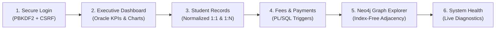

# Faculty Viva & Demonstration Guide

**Project:** Scholarship and Fee Management System  
**Platform Architecture:** Unified Oracle SQL/PLSQL + Neo4j Graph Database  
**Author:** spranjal-0723  
**Verified Application URL:** `http://127.0.0.1:5050/app`  
**Demo Credentials:** `admin@scholarship.demo` / `Demo@12345` (Role: Demo Administrator)

---

## 1. Five-Minute Viva Demonstration Script

This structured 5-minute walkthrough is designed for university faculty evaluations, oral viva examinations, and lab assessments. It systematically demonstrates how relational DBMS concepts (DA-1, DA-2) and graph database concepts (DA-3) work together in a unified enterprise application.

---

### Step 1: Secure Authentication & Landing (0:00 – 0:45)
1. **Open the browser:** Navigate to `http://127.0.0.1:5050/app`.
2. **Explain the Landing Hero:** Point out the clean academic SaaS hero displaying the three primary operational pillars:
   - *Student & Academic Management*
   - *Scholarships & Financial Aid*
   - *Fee Tracking & Graph Analytics*
3. **Demonstrate Demo Autofill:** Click **"Auto-Fill Demo Credentials"** on the right card to populate `admin@scholarship.demo` and `Demo@12345`.
4. **Explain Security Implementation:**
   - Server-side Flask session authentication with `HttpOnly` and `SameSite=Lax` cookies.
   - Password hashed with Werkzeug PBKDF2-SHA256 (no plaintext stored or transmitted in URLs).
   - In-memory rate limiting (max 5 failed attempts/minute).
   - Cryptographic 32-byte CSRF token generated and verified on all state-changing endpoints.
5. **Log In:** Click **"Sign In to Portal"**. The hero smoothly transitions into the main management dashboard.

---

### Step 2: Executive Overview Dashboard (0:45 – 1:30)
1. **Show KPI Metric Cards:**
   - *Total Enrolled Students:* `25`
   - *Total Scholarship Pool:* `₹700,000` (across 15 active scholarship schemes)
   - *Total Assessed Fees:* `₹1,760,000`
   - *Total Collected Payments:* `₹1,080,000`
   - *Outstanding Balance:* `₹680,000`
2. **Review Chart.js Visualizations:**
   - *Fee Collection vs. Outstanding:* Visual balance tracking.
   - *Scholarship Distribution by Category:* Merit, Need-Based, Departmental, Sports.
   - *Application Status Funnel:* Approved (`20`), Pending (`11`), Rejected (`4`).
   - *Academic Program Enrollment Density:* Computer Science, AI&DS, ECE, Mechanical.
3. **DBMS Concept Highlight:** Real-time SQL aggregation using Oracle `SUM()`, `COUNT()`, and `NVL()` expressions without pre-computed table anomalies.

---

### Step 3: Students & Academic Records (1:30 – 2:15)
1. **Navigate to:** **Students & Academics** tab (`#tab-students`).
2. **Demonstrate Relational Joins:** The student directory displays data synthesized from:
   - `STUDENT` (Base identification, CGPA, email)
   - `DEPARTMENT` (Department name via `DeptID` foreign key)
   - `PROGRAM` (Degree program via `ProgramID` foreign key)
   - `STUDENT_PROFILE` (1:1 personal details, address, phone)
3. **Inspect Representative Student `S001` (Aarav Sharma):**
   - Click **"View Profile"** to open the slide-out student detail drawer.
   - Note the academic standing (CGPA: `9.42`, Department: *Computer Science & Engineering*, Program: *B.Tech Computer Science*).
   - Review related financial summary showing fee obligations and awarded scholarships.

---

### Step 4: Fees, Payments & PL/SQL Business Logic (2:15 – 3:15)
1. **Navigate to:** **Fees & Payments** tab (`#tab-fees`).
2. **Review Fee Invoicing:** Inspect fee records (e.g. `F001` for Student `S001` with amount `₹50,000`).
3. **Demonstrate Overpayment Safeguard (PL/SQL Trigger):**
   - Click **"Record Payment"** for a fee record.
   - Explain trigger `TRG_CHECK_FEE_PAYMENT`: A row-level `BEFORE INSERT` trigger on `FEE_PAYMENT` that queries total prior payments for that `FeeID`.
   - If `(Prior Payments + New Amount) > FeeAmount`, Oracle raises application error `-20001: Total payment cannot exceed fee amount!`.
   - The Flask backend catches this Oracle error and safely translates it to a client notification without leaking database internals.
4. **Review Payment Methods:** Shows normalized lookup table `PAYMENT_METHOD` supporting UPI, Net Banking, Credit/Debit Card, and Demand Draft.

---

### Step 5: Signature Neo4j Graph Explorer (3:15 – 4:15)
1. **Navigate to:** **Neo4j Graph Explorer** tab (`#tab-graph`).
2. **Explain Why a Graph Database is Used (DA-3):**
   - Relational databases require multi-table JOINs (`STUDENT` $\rightarrow$ `STUDENT_FEE` $\rightarrow$ `FEE_PAYMENT` $\rightarrow$ `PAYMENT_METHOD` $\rightarrow$ `SCHOLARSHIP_APPLICATION` $\rightarrow$ `SCHOLARSHIP`). As joins increase, relational performance degrades.
   - Neo4j utilizes **index-free adjacency**, where nodes store direct physical pointers to their neighbors ($O(1)$ traversal complexity).
3. **Explore the Curated Graph Presets:**
   - **Student Journey (Default):** Explores 5 representative students (`S001`–`S005`) and their connected programs, fee records, payments, and scholarship awards (47 nodes, 48 edges).
   - **Scholarship Lifecycle:** Traces `(Student)-[:SUBMITTED]->(Application)-[:AWARDS]->(Scholarship)-[:HAS_DISBURSEMENT]->(Disbursement)`.
   - **Fee Payment Flow:** Traces `(Student)-[:HAS_FEE]->(Fee)-[:HAS_PAYMENT]->(Payment)-[:PAID_VIA]->(PaymentMethod)`.
   - **Department Network:** Explores `(Department)-[:HAS_PROGRAM]->(Program)-[:HAS_STUDENT]->(Student)`.
   - **Complete Knowledge Graph:** Full multi-entity topology across all 12 node types.
4. **Interactive Exploration:**
   - Click node `S001` on canvas: Connected 1-hop neighbors highlight while unrelated nodes dim to 15% opacity.
   - Right-hand **Node Inspector Drawer** instantly displays all graph properties (`studentId`, `name`, `cgpa`) and inbound/outbound edge lists.
   - Expand the **"Understanding This Knowledge Graph"** educational guide panel.

---

### Step 6: System Diagnostics & Health (4:15 – 5:00)
1. **Navigate to:** **System Diagnostics** tab (`#tab-system`).
2. **Review Live Telemetry:**
   - *Flask Application API:* Healthy (200 OK) on port 5050.
   - *Oracle SQL Database:* Connected on port 1521 (12 active tables).
   - *Neo4j Graph Database:* Connected on bolt 7687 (12 node labels).
3. **Verify Component Record Volumes:**
   - *Oracle Relational Records:* `250` verified across all 12 relational tables.
   - *Neo4j Graph Nodes:* `250` nodes.
   - *Neo4j Graph Relationships:* `280` directed relationships.
4. **Demonstrate Live Ping:** Click **"Test Roundtrip Latency"** under Advanced Telemetry to display live millisecond response times.
5. **Sign Out:** Click **"Sign Out"** in the topbar or sidebar footer to demonstrate session invalidation and return to the secure landing hero.

---

## 2. Key Canonical Records to Inspect

| Record Type | Identifier | Name / Description | Key Attributes | Relevant DBMS Concept |
| :--- | :--- | :--- | :--- | :--- |
| **Student** | `S001` | Aarav Sharma | CGPA: `9.42`, B.Tech CS | Primary Key, 1:1 Profile FK |
| **Student** | `S002` | Diya Patel | CGPA: `9.15`, B.Tech AI&DS | Foreign Key to `PROGRAM` |
| **Scholarship** | `SCH001` | Merit Excellence Scholarship | Amount: `₹50,000`, Min CGPA: `8.50` | CHECK constraint on amount |
| **Scholarship** | `SCH002` | Women in Technology Grant | Amount: `₹40,000`, Category: `Special` | Aid pool allocation |
| **Application** | `A001` | Application by `S001` | Status: `Approved`, Awarded: `SCH001` | State machine validation |
| **Fee Invoice** | `F001` | Tuition Fee Term 1 | Amount: `₹50,000`, Due: `2026-03-01` | Outstanding balance logic |
| **Payment** | `PAY001` | Installment 1 for `F001` | Amount: `₹25,000`, Method: `UPI` | `TRG_CHECK_FEE_PAYMENT` |
| **Payment** | `PAY005` | Installment 2 for `F001` | Amount: `₹10,000`, Method: `UPI` | Cumulative payment check |
| **Disbursement** | `DIS001` | Grant release for `SCH001` | Amount: `₹50,000`, Mode: `Bank Transfer` | `CHK_DISBURSEMENT_MODE` |
| **Bank Account** | `BA001` | State Bank of India | Account: `SBIN001001` | Unique constraint, IFSC code |

---

## 3. DBMS Viva Questions & Answers

### Q1: Why does this project use both Oracle and Neo4j?
**Answer:**
> "The project implements a **polyglot persistence architecture**. Oracle SQL provides ACID guarantees, strict schema constraints, and transactional consistency for financial transactions (fee payments and disbursements). Neo4j provides high-performance graph traversals for interconnected academic relationships (student cohorts, multi-tier scholarship dependencies, payment networks). In Neo4j, traversing relationships uses physical pointers ($O(1)$) rather than relational multi-table index joins ($O(\log N)$)."

### Q2: How does the Oracle database prevent overpayments?
**Answer:**
> "Overpayment prevention is enforced at the database kernel level through a PL/SQL row-level trigger `TRG_CHECK_FEE_PAYMENT` on the `FEE_PAYMENT` table. Before any payment is inserted, the trigger calculates the sum of all existing payments for that `FeeID` plus the new payment amount. If this exceeds the `FeeAmount` defined in `STUDENT_FEE`, the trigger invokes `RAISE_APPLICATION_ERROR(-20001, ...)`, aborting the transaction."

### Q3: What normal form is the Oracle relational schema in?
**Answer:**
> "The relational schema is in **Third Normal Form (3NF)**:
> 1. **1NF:** All attributes contain atomic values; each table has a unique primary key.
> 2. **2NF:** All non-key attributes are fully functionally dependent on the entire primary key (no partial dependencies).
> 3. **3NF:** No non-key attribute is transitively dependent on the primary key. For example, student personal details are factored into `STUDENT_PROFILE`, program details into `PROGRAM`, and department details into `DEPARTMENT`."

### Q4: How are relational entities mapped to the Neo4j graph model?
**Answer:**
> "Relational tables map to Neo4j **Node Labels** (e.g. `STUDENT` $\rightarrow$ `:Student`, `SCHOLARSHIP` $\rightarrow$ `:Scholarship`). Relational foreign keys map to directed **Relationships** with semantic verb names:
> - `STUDENT.ProgramID` $\rightarrow$ `(:Program)-[:HAS_STUDENT]->(:Student)`
> - `SCHOLARSHIP_APPLICATION.StudentID` $\rightarrow$ `(:Student)-[:SUBMITTED]->(:Application)`
> - `SCHOLARSHIP_APPLICATION.ScholarshipID` $\rightarrow$ `(:Application)-[:AWARDS]->(:Scholarship)`
> - `FEE_PAYMENT.FeeID` $\rightarrow$ `(:Fee)-[:HAS_PAYMENT]->(:Payment)`
> - `DISBURSEMENT.AccountNo` $\rightarrow$ `(:Disbursement)-[:TO_ACCOUNT]->(:BankAccount)`"

---

## 4. Common Troubleshooting Steps

| Issue | Cause | Resolution Command |
| :--- | :--- | :--- |
| **Port 5050 already in use** | A previous Flask process is still running | `lsof -ti :5050 \| xargs kill -9` |
| **Oracle connection fails** | Docker container is stopped | `docker start oracle-free` |
| **Neo4j connection fails** | Docker container is stopped | `docker start scholarship-neo4j` |
| **Missing Python packages** | Virtual environment dependencies not loaded | `source backend/venv/bin/activate && pip install -r requirements.txt` |
| **Database records empty** | Demo dataset needs re-seeding | `backend/venv/bin/python scripts/seed_demo_data.py` |
| **Run all automated tests** | Test verification | `backend/venv/bin/pytest tests/` (180 tests) |
